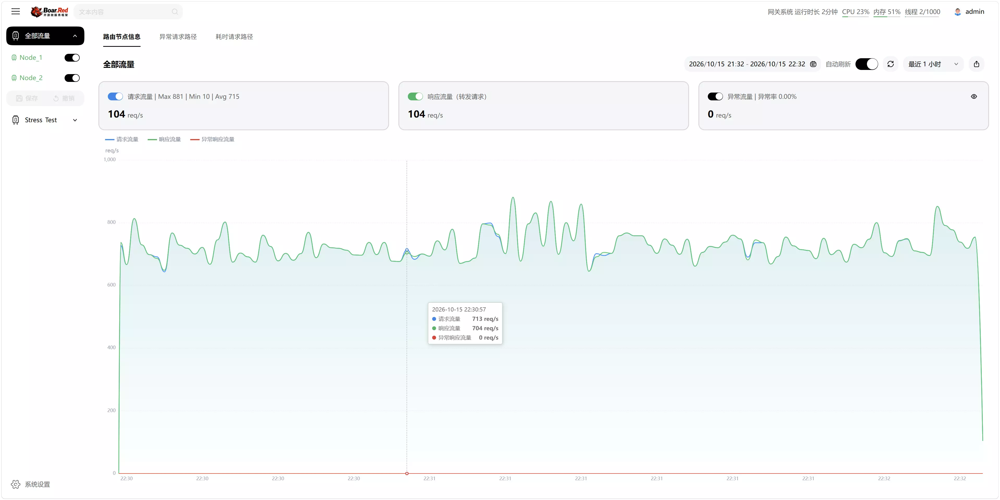
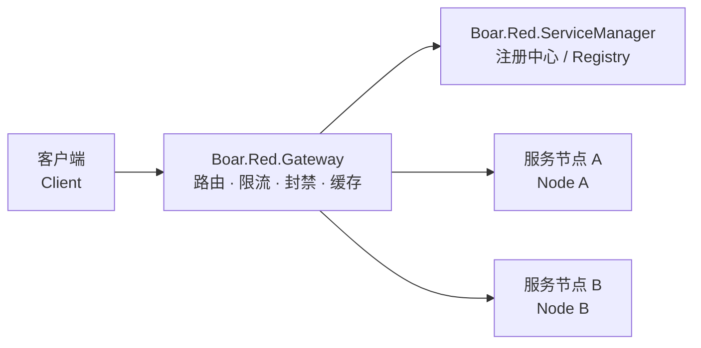

# Boar.Red.Gateway

[](LICENSE)
[](https://dotnet.microsoft.com/)

Boar.Red 微服务框架（微服务架构），网关服务。负责把外部请求按规则路由到后端微服务节点，并提供限流、IP 封禁、响应缓存、统计等流量层能力。

Boar.Red Service framework — the gateway service. It routes external requests to backend microservice nodes by configurable rules, and adds traffic-layer capabilities such as rate limiting, IP blocking, response caching and statistics.

---

## 特性

- **规则路由**：基于 `RouteRule` 将请求转发到服务节点（EndPoint），支持目录匹配与**数学表达式匹配**转发规则。
- **路由 URL 前缀**：通过 `RouteRequestPathSpliter` 灵活选择路由前缀风格（`@` / `~` / 空前缀）。
- **限流与流量切换**：支持 `RPSMax`、`EndPointRPSMax` 与 `IsDisableWhenRPSOverMax`；当终点流量超过最大值时，自动将超出的流量切换至其他节点。
- **IP 封禁**：内置 IP 封禁记录的增加、查询、更新、移除接口。
- **响应缓存**：支持对后端响应进行缓存与刷新。
- **HTTP 302 透传**：EndPoint 返回的 302 跳转直接转发给客户端，而不是在网关环节跳转。
- **管理接口**：路由统计、日志文件查看、配置管理等内置控制器。

## 界面预览 / Screenshots

流量看板：按路由/节点查看请求流量、响应流量（转发请求）与异常流量曲线，支持时间范围筛选与自动刷新。

Traffic dashboard: request / response (forwarded) / error traffic curves per route & node, with time-range filtering and auto refresh.



## Features

- **Rule-based routing**: forwards requests from `RouteRule` entries to service endpoints (EndPoints), with directory matching and **math-expression matching** rules.
- **Route URL prefix**: choose the routing prefix style via `RouteRequestPathSpliter` (`@` / `~` / empty).
- **Rate limiting & traffic switching**: `RPSMax`, `EndPointRPSMax` and `IsDisableWhenRPSOverMax`; traffic exceeding an endpoint's limit is automatically switched to other nodes.
- **IP blocking**: built-in APIs to add, query, update and remove IP block records.
- **Response caching**: cache and refresh backend responses.
- **HTTP 302 pass-through**: 302 redirects from endpoints are forwarded to the client instead of being followed by the gateway.
- **Admin APIs**: route statistics, log file viewing, config management and more.

---

## 在框架中的位置 / Where it Fits



依赖关系 / Dependency: 本仓库包含三个项目，均引用 [Boar.Red.Service](https://github.com/Boar-Red/Boar.Red.Service)：

| 项目 / Project | 说明 / Description |
| --- | --- |
| `Boar.Red.Gateway` | 网关服务本体（Web 宿主）/ the gateway web host itself |
| `Boar.Red.Gateway.Defines` | 服务端/客户端共享定义（HTTP 头、IP 封禁模型等）/ shared definitions (headers, IP block models) |
| `Boar.Red.Gateway.Client` | 客户端调用封装（可打 NuGet 包）/ client wrapper (published as a NuGet package) |

---

## 快速开始 / Quick Start

### 兄弟目录克隆 / Sibling-directory Clone

本仓库通过相对路径引用 `Boar.Red.Service`，必须按兄弟目录布局 clone：

This repo references `Boar.Red.Service` by relative path, so clone it as a sibling:

```bash
git clone https://github.com/Boar-Red/Boar.Red.Service
git clone https://github.com/Boar-Red/Boar.Red.Gateway
```

> ⚠️ 目录名必须保持不变，否则编译时找不到项目引用。
> ⚠️ Do not rename the directories, or the project references will break.

### 编译运行 / Build & Run

环境要求 / Requirements：.NET 10 SDK。

```bash
cd Boar.Red.Gateway
dotnet build Boar.Red.Gateway.slnx
dotnet run --project Boar.Red.Gateway
```

监听地址与端口由 `ConfigFiles/RouterConfig.json` 的 `WebServiceConfig` 控制（`HttpPort` 小于等于 `0` 时使用 `80`；默认空 IP 绑定所有网卡）。

The listen address and port come from `WebServiceConfig` in `ConfigFiles/RouterConfig.json` (a non-positive `HttpPort` uses port `80`; an empty IP binds all interfaces).

### Visual Studio 完整流量转发体验 / Full Forwarding Demo

使用支持 .NET 10 的 Visual Studio 打开 `Boar.Red.Gateway.slnx`，选择 `Debug` 构建配置，再在启动配置下拉框中选择 **Gateway完整流量转发测试**，按 F5 启动。

共享方案保存在 [`Boar.Red.Gateway.slnLaunch`](Boar.Red.Gateway.slnLaunch)，依次启动测试端点、网关和流量测试程序，项目路径均相对于解决方案目录。网关和测试端点的调试目标分别选择其同名项目启动配置。

测试程序默认等待 10 秒后开始并发转发测试，当前默认时长为 60 分钟；可随时通过 Visual Studio 停止调试结束体验。测试入口和启用的测试类型见 [`Main.cs`](Boar.Red.Gateway.Test/Main.cs)。

Open `Boar.Red.Gateway.slnx` in a Visual Studio version that supports .NET 10, choose the `Debug` configuration and the **Gateway完整流量转发测试** launch profile, then press F5. The shared profile starts the endpoint, gateway and traffic test program in that order. Select the matching project launch targets for the gateway and endpoint. The test waits 10 seconds before starting and currently runs for up to 60 minutes; stop debugging whenever you finish the demo.

以后修改共享方案时，在“配置启动项目”中勾选 **共享配置 / Share Profile**，保存到 `.slnLaunch`。个人的 `.slnLaunch.user` 继续由 `.gitignore` 忽略。

When editing this shared profile, enable **Share Profile** in Configure Startup Projects. Shared profiles belong in `.slnLaunch`; personal `.slnLaunch.user` files remain ignored.

---

## 路由 URL 前缀 / Route URL Prefix

`RouterConfig.json` 的 `RouteRequestPathSpliter` 控制请求 URL 的路由目录前缀，未配置时使用 `@`。可以通过管理页面的"系统高级配置"修改，保存或上传配置后需要重启网关才会生效。

`RouteRequestPathSpliter` in `RouterConfig.json` controls the routing directory prefix of the request URL; defaults to `@`. It can be changed in the admin console under "系统高级配置" (advanced settings); the gateway must be restarted after saving or uploading a new config.

- `"@"`：`/@Stress_Test/get`，无目录请求使用 `/@/get`。
- `"~"`：`/~Stress_Test/get`，无目录请求使用 `/~/get`。
- `""`：`/Stress_Test/get`；第一段仍为路由目录，不提供无目录入口，也不会自动保留旧前缀。

支持英文字母、数字和 `@ ~ ! $ _ -`，不支持斜杠、空白、查询符号或路由模板字符。配置规则中的目录标记固定为 `@`，原有 `@Stress_Test/*` 和 `*` 规则不需要修改。

空前缀模式下，网关内置控制器名称以及 `admin`、`assets` 目录保留给管理接口和页面，不能作为转发目录。已有静态文件和网关 WebSocket 服务优先处理。

---

## 配置说明 / Configuration

`ConfigFiles/RouterConfig.json`（支持 `//` 注释）主要配置节 / main sections:

| 配置节 / Section | 说明 / Description |
| --- | --- |
| `WebServiceConfig` | 监听 IP/端口、HTTPS 证书、静态页 / listen IP/port, HTTPS certificates, static files |
| `RouterConfig` 相关节 | 路由规则、EndPoint、限流、响应缓存等 / route rules, endpoints, rate limits, response cache |
| 管理员配置节 | 网关管理员账号 / gateway administrator accounts |

> ⚠️ 配置文件中的管理员账号、SMTP 密码与 AES 密钥均为**本地示例值**，部署时必须全部更换。
> ⚠️ All administrator accounts, SMTP passwords and AES keys in the sample configs are **local examples only** and MUST be replaced in production.

---

## 更新日志 / Changelog

历史版本的手工更新记录已迁移至 [CHANGELOG.md](CHANGELOG.md)。

Historical manual release notes have been moved to [CHANGELOG.md](CHANGELOG.md).

---

## 管理 UI / Management UI

管理 UI 源码暂时闭源，仓库随附的 `wwwroot/` 静态产物用于体验，构建服务端不需要 UI 源码。根目录 MIT License 适用于开源服务端代码和文档；自有管理 UI 不在其授权范围内，见 [UI 授权说明](UI-LICENSE.md)。

The management UI source is currently closed. The prebuilt assets in `wwwroot/` are bundled for evaluation; the server builds without the UI source. The root MIT License covers the open-source server code and documentation; see the separate [UI notice](UI-LICENSE.md).

## 自动检查 / Automated Checks

每次提交和 Pull Request 的构建、测试、依赖审计及更新方式见 [CI 说明](docs/ci.md)。

See [CI and dependency updates](docs/ci.md) for automated build, test and dependency checks.

## 许可证 / License

本项目的开源服务端代码与文档采用 [MIT License](LICENSE)，Copyright © 2026 Boar.Red；管理 UI 另见 [UI 授权说明](UI-LICENSE.md)。

The open-source server code and documentation use the [MIT License](LICENSE), Copyright © 2026 Boar.Red. The management UI has a separate [UI notice](UI-LICENSE.md).
